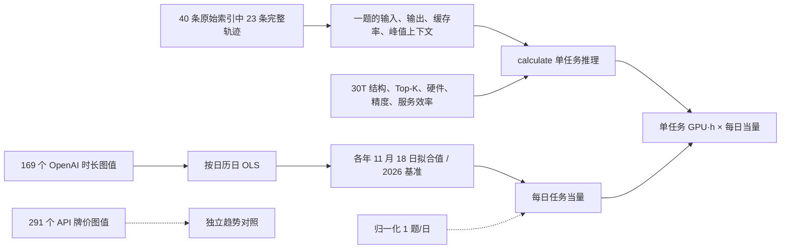

# 第一层现状审计与改动范围

基线提交 e0fec24。图中虚线表示输出时仍依赖情景选择。

|审计对象|当前输入、处理与输出|修改范围|
|---|---|---|
|observed_agent_workdays、observed_api_usage_value|169/291 行，日期键分别对应同一官方交互图的时长及牌价字段|原样读取，记录出处、字段和快照指纹|
|linear_usage_projection|距首日天数 x；b=Σ(x−x̄)(y−ȳ)/Σ(x−x̄)²；a=ȳ−bx̄。usage_multiplier 为两期拟合值的比|复用旧 OLS 口径，独立增加短窗、分段、非负、有界对照|
|reference_tasks_per_day、dayscale|1 是计量基准；旧版把整个时长倍率传给单主 Agent|显式分解会话数量、时长、任务强度，区分研究员与单主 Agent 分母|
|trace_sample、workload(row)|按输出排序选整题。prompt 是逐调用累计输入，completion 包含已计的推理 Token，cache_read 是输入子集。peak_request 是每题最大请求总长度。峰值序列固定为 1|保留成对轨迹，另核实逐请求长度与会话持续时间；生产请求峰值尚不可识别|
|旧版第一层输出|usage_projection.csv 含机构趋势与基准日 Token；forecast_summary.csv 混合日工作量与每题设备指标。不能单独还原会话数、活跃并发或请求长度分布|新增独立版本目录、结构化工作负载、原生图表与测试|
|第二层交界|calculate 接收 input_tokens / output_tokens（每题）、prefix_cache_hit_rate、context_tokens、peak_sequences；日工作量在外部乘任务当量。SKU、精度、模型结构、批大小、TP/EP 属服务配置|复用五字段接口和外部按题加权。会话驻留、跨主 Agent 并发留在第一层|
|旧接口与文件|旧入口、配置、CSV 全部列名与值、calculate 参数与返回（GPU·h、FLOPs、HBM、卡数）是回归基线|旧配置在临时目录复算、逐字节比较；不写历史文件|

实施范围为新 workload 目录内的独立第一层、适配输入、证据、可视化和测试。第二层按同一输入检验完整结果。已归档的旧结果是验收参照。
