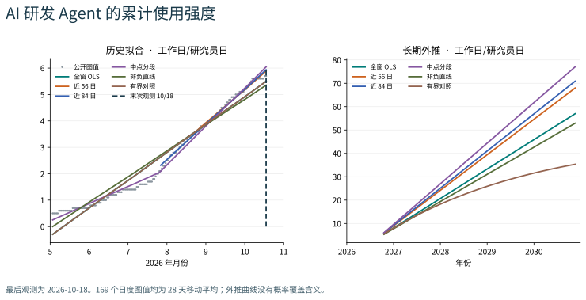
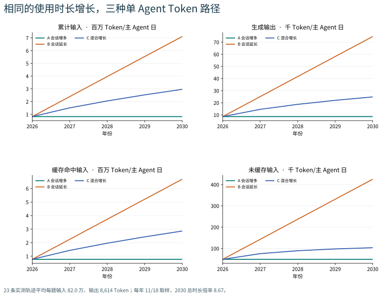
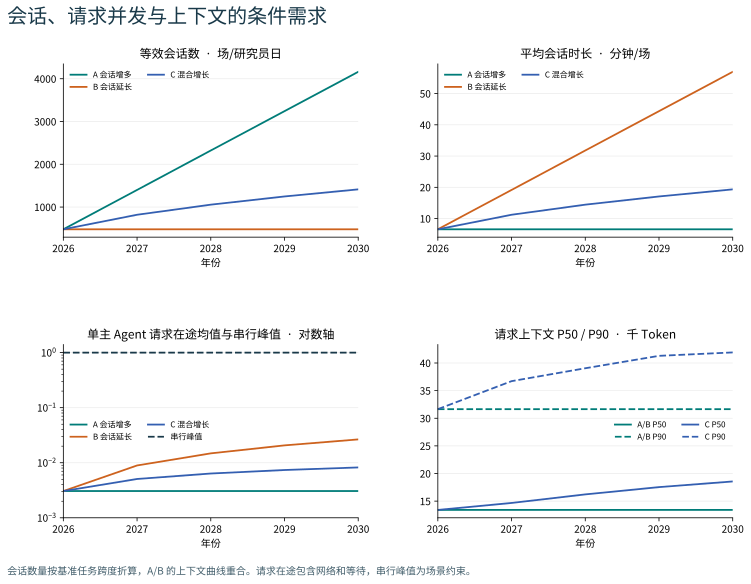

# 未来 AI 推理基础设施需求

## 研究员总体使用量能外推到哪里？



## 同一增长可以产生多少单 Agent Token？



## 服务系统还要承担多少会话和请求？



[可编辑演示文稿，4 页、10 张原生数据图](figures/未来AI推理基础设施需求.pptx) · [现状依赖图与审计](AUDIT.md) · [证据及适用范围](evidence.md)

### 2030 年工作负载

同一个全窗线性外推给出 56.96 个八小时 Agent 日/研究员日，即 455.70 个累计会话小时/日，摊到全天约 18.99 个同时在线的会话当量。2026 年 11 月基准本身也是外推截面，6.57 个八小时日，对应增长倍率 8.67。它可能由更多 Agent 分担，也可能由既有 Agent 延长工作时间。以下固定研究员总小时，逐列改变分解条件。Token、调用和任务均以**一个焦点主 Agent 的自然日**为分母。

|2030-11-18|A：主要增加会话|B：主要延长会话|C：数量、时长和任务构成共同变化|
|---|---:|---:|---:|
|日任务当量|1.00|8.67|1.94|
|每题调用 / 每日调用|50.96 / 50.96|50.96 / 441.87|71.64 / 138.71|
|输入 Token/日|820,209|7,112,396|2,964,522|
|其中缓存输入 / 未缓存|771,171 / 49,039|6,687,159 / 425,236|2,860,991 / 103,531|
|输出 Token/日|8,614|74,695|24,879|
|等效会话数 / **研究员日**|4,162|480|1,414|
|平均分钟/会话|6.57|56.96|19.34|
|主 Agent 日均请求在途并发代理|0.0031|0.0265|0.0082|
|请求上下文 P50 / P90，Token|13,416 / 31,646|13,416 / 31,646|18,566 / 41,913|

新报告的基准工作组合为 23 条有效轨迹等权，每天平均一题；旧版基准使用按输出中位选中的单条 Django 轨迹。两种工作组合分别保存。这里的数千场等效会话是短编码任务跨度外推的结果，对时长假设非常敏感。由这些数值无法推断一名研究员确实创建了几千个不同 Agent。目标环境未披露实际 session 分布、在途请求 P95、物理 GPU 忙碌并发或缓存驻留时间。

### 趋势和可识别范围

|方法|拟合约束|2030 工作日/研究员日|2030/2026|
|---|---|---:|---:|
|OLS|全部 169 个图值等权|56.96|8.67|
|近 56 日|预先指定短窗|67.97|9.47|
|近 84 日|预先指定短窗|70.90|9.73|
|连续分段|预先取观测期中点 t=84，拟合 a+bt+c·max(0,t−84)|77.03|10.24|
|非负直线|在 a≥0、b≥0 的可行域求最小平方误差，保证 t≥0 的非负性|52.90|8.34|
|有界对照|历史采用 OLS，从末日按原斜率平滑趋近情景上限 48|35.34|5.39|

有界曲线在最后观测日之后取 K−(K−L)exp(−bΔt/(K−L))，L 是当天全窗拟合值。K=16×24/8；这是一种条件性容量压力端点。每条曲线按自己的 2026-11-18 拟合值归一。若目标机构不能承受 OLS 暗含的 18.99 个全天在线会话当量，有界路径展示了容量限制可能带来的差异。样本期内 OLS R²=0.959，最后 28 日留出 MAE=0.619；28 天平滑造成跨切分重叠，四年外推的误差仍未知。短窗和不同模型的跨度只描述方法敏感性。API 牌价、自动化等级与工具链长度各自保留独立口径。[六种方法的系数与留出误差](results/trend_fits.csv) · [全部年度与倍率](results/trends.csv)

### 会话分解与任务计量

设趋势预测总小时为 H，基准为 H₀，G=H/H₀。参考任务的均值跨度 d₀ 取 23 条轨迹的可见请求区间跨度均值，按参考题数换算基准焦点会话时长。N₀=H₀/d₀。选 p=1、0 或 ½ 后，研究员会话数 N=N₀Gᵖ，平均会话时长 d=d₀G¹⁻ᵖ，故 N×d=H。平均在线会话数为 H/24。这里把跨日会话按在窗口内的时长归属，数量为等效场次。

焦点主 Agent 每日一场串行会话，其日任务当量为 d / 加权平均每题跨度。A、B 让样本构成固定，C 从完整经验分布逐年线性转向一个混合：2030 一半权重给完整分布、一半给按输出排名前十分位的任务。该处理同时改变每题调用、Token、缓存和时长；它对复杂任务权重的取值是情景。各题始终成组进入计算，不按指标拼接分位数。日输入等于各题日当量乘各题 prompt 的总和；输出、缓存及调用同理。缓存率按 Token 加权。平均请求在途时间占比由加权请求区间并集时间/加权跨度推导。日均在途并发等于焦点会话小时 × 此占比 / 24。串行运行给出主 Agent 在途峰值 1；研究员池及集群峰值仍未识别。A 的池并发增加可能抬升 KV 驻留需求，实际显存需设备调度与销毁策略。

上下文主表是各请求 prompt+completion 的分布，服务报告可用 P50/P90。第二层使用**每题峰值长度**代表该题。C 的分位变化仅源于任务构成；单题 context 缺乏可比时间序列。[原长度及 2 倍条件压力](results/context_stress.csv)

会话时长与在途占比还可分别采用完整轨迹的加权 P10/P90 做条件压力。在 2030 路径 B，仅替换会话时长代理，固定 455.70 总小时会得到约 286–1,136 个等效会话/研究员日；仅替换在途占比，焦点日均请求并发为 0.021–0.037。两项单因素结果不拼成同一条实测轨迹。研究员请求峰值及 P95 列留空表示生产时序不足。[会话参数敏感性](results/session_sensitivity.csv)

### 第二层接口

|类型|字段及分母|处理|
|---|---|---|
|直接传入|input_tokens、output_tokens（每题），prefix_cache_hit_rate（每题命中输入比例），context_tokens（每题请求峰值），peak_sequences（当前主 Agent 串行峰值 1）|对每条真实 trace 生成一个 calculate 工作负载|
|适配|tasks_per_day；条目上是该 trace 的日权重，汇总表上是全部 trace 当量之和|每题计算后将可加的工作量如 GPU·h 乘条目权重再求和；副本卡数与峰值显存须按服务布局处理|
|第一层分析|calls_per_task/day、cached/uncached_input_tokens_day、session_hours_per_day、session_count_per_day、average_online_sessions、average/peak_inference_concurrency、context_request_p50/p90、evidence_type 等|留存全部 6×5×3 个截面；池级会话和主 Agent 直接推理量分别汇报|

[workload.csv](results/workload.csv) 给出所有趋势与情景；[inference_inputs.json](results/inference_inputs.json) 给出主 OLS 下 5 年 × 3 路径 × 23 题的原生输入和日权重。以下例子直接调用已有 30T 配置，以 H100 基础服务配置演示接口。若要复用历史年度精度和硬件路线，沿用旧 forecast.py 对当年 model_path/hardware_path 的选择；2029 年目前只定义工作负载。

```python
import json
from pathlib import Path
from inference.moe import calculate

path = Path("analysis/agentic_30t_forecast/workload/results/inference_inputs.json")
jobs = [j for j in json.loads(path.read_text()) if j["year"] == 2030 and j["scenario"] == "B"]
hours = sum(j["tasks_per_day"] * calculate(j["workload"], "H100_SXM",
            model_path="config/models/moe_30t.json")["infer_gpu_h"] for j in jobs)
```

### 复算与核验

在仓库根目录运行。预测和回归测试仅需 Python 标准库。图表另用 matplotlib、python-pptx、XlsxWriter 和中文字体；PPT 内含可编辑的 XY 数据系列和 Excel 工作簿。

```bash
python3 -B -m analysis.agentic_30t_forecast.workload.forecast
python3 -B -m analysis.agentic_30t_forecast.workload.charts
PYTHONDONTWRITEBYTECODE=1 python3 -m unittest discover -s tests -v
```

原始快照保持独立。如需在线逐题重新提取时间戳和上下文数据，可运行 `python3 -B -m analysis.agentic_30t_forecast.workload.observations /tmp/trace_calls.csv`，再与发布的 [trace_calls.csv](trace_calls.csv) 比较。调节情景见 [settings.json](settings.json)。参数类别、来源、分母与不确定性见[证据报告](evidence.md)。
