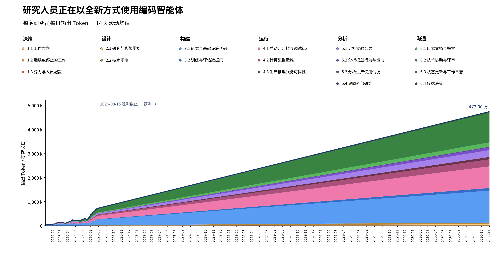
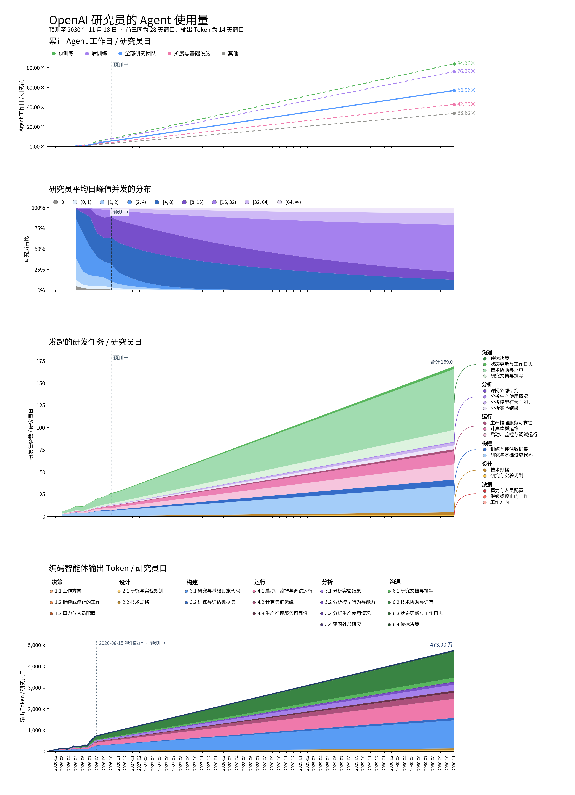

# 未来 AI 推理基础设施需求

## 以研发任务发起数预测每研究员日负载

2030-11-18，延续各类任务发起率的历史线性斜率，预测为 **168.96 项/研究员自然日**。每天的输入、缓存输入和输出分别按 18 个类别的研究员日量加总。对预测发起率大于零的类别，可以用该类日量除以发起率得到每次发起的条件强度。[OpenAI 发起率原图](https://openai.com/index/research-acceleration-jagged-frontier/#figure-research-task-starts) · [输出原图](https://openai.com/index/research-acceleration-view-inside-openai/#chart-4QLdZ4iw0n4L9rYGTvteZK) · [校准报告](calibration/REPORT.md)

### 每研究员自然日，由 18 类研发任务发起率推算

三列共用全速线性发起率，仅改变编码代理的构成或会话组织；其中 3.1 类“研发与基础设施代码”为 29.86 项/日。范围覆盖 OpenAI 统计的交互式研发任务。真实全量还可能包含报告排除的程序化自动化流量。

| 指标 | A | B | C |
|---|---:|---:|---:|
| 累计 Agent 小时（独立时长预算） | 455.70 | 455.70 | 455.70 |
| 研发任务发起数/研究员日 | 168.96 | 168.96 | 168.96 |
| 原有历史强度的 11 类，直接外推输出（万 Token） | 461.18 | 461.18 | 461.18 |
| 原缺历史强度的 7 类，直接外推输出（万 Token） | 10.02 | 10.02 | 10.02 |
| 18 类输出合计（万 Token） | 471.20 | 471.20 | 471.20 |
| 条件累计输入（亿 Token） | 4.6693 | 4.6693 | 5.4192 |
| 其中缓存输入（亿 Token） | 4.3827 | 4.3827 | 5.2097 |
| 其中需预填充的输入（亿 Token） | 0.2866 | 0.2866 | 0.2095 |
| 条件输入与输出合计（亿 Token） | 4.7164 | 4.7164 | 5.4664 |
| 30T Top‑8 条件推理计算量（EFLOP/日） | 5.2730 | 5.2730 | 5.0386 |

**研发任务发起数（168.96 项）。** OpenAI 11 月的任务图基于研发人员的交互式编码 Agent 日志。研究团队抽取上下文窗口，识别用户发起的研发任务，排除已知自动化等流量，对非零账户的日发起数按 P95 截尾，再除以当日抽样率和活跃研发名册人数。图中分母是研究员自然日，发布的是 28 天滚动均值。2026-10-18 的 18 类图值合计约 26.3 项。本模型使用 3 月 1 日至 10 月 18 日的 232 个图值，对每类按日历时间拟合直线，延续历史斜率到 2030-11-18，逐类取非负值后加总得到 168.9584 项。A/B/C 共用这一路径。[OpenAI 任务原图及方法](https://openai.com/index/research-acceleration-jagged-frontier/#figure-research-task-starts) · [逐类发起率](results/calibrated/rates_by_category.csv)

**18 类输出均按自己的历史输出趋势预测。** 9 月报告公开 208 个日度图值，每类从 2026-08-15 的末值沿全历史线性斜率外推，取非负值。2030-11-18 的 14 日口径合计 473.00 万输出 Token；与发起率对齐时，对每类取 11 月 4 日和 18 日两个相邻 14 日窗口的平均，18 类合计为 471.20 万。原有历史强度的 11 类贡献 461.18 万，另外 7 类贡献 10.02 万。11/7 仅用于与旧版对照，各类均有自己的输出序列。[逐月双窗口预测](results/monthly_output_and_task_starts.csv) · [18 类复算明细](results/calibrated/category_token_ledger_2030.csv)

**发起数与输出独立外推。** 其中 1.2 类和 5.4 类的预测发起数为零，输出预测分别为 1,984 和 4,362 Token/研究员日。这两类的单次强度留空，直接把日量计入上述 7 类小计。全类别计算可写为 Tₓ = Σ（Nₖ > 0 的类别：Nₖ × μₖ,ₓ）+ Σ（Nₖ = 0 的类别：独立预测的日量）。全体平均 27,888 输出 Token/次发起来自总输出除以总发起率。

**输入、缓存与计算量的附加条件。** 缺少 18 类各自的输入和缓存账单。表中作压力测试，对每类的条件输出分别乘以该情景编码样本的“累计输入/累计输出”和“累计缓存输入/累计输出”。同一分布的各题用其自身的缓存率和上下文运行 30T Top‑8 内核，将加权的 EFLOP 除以加权的输出 Token，再按各类输出规模求和。A/B 使用 252 个完整编码题等权的比例，同一任务量给出相同资源。C 给全体题和输出最高的 26 题各 50% 权重。C 借用的输入缓存率更高，未缓存输入较少，导致其条件 EFLOP 更低。上述资源数值依赖编码比例向全部类别迁移；实际全研发输入、缓存及 EFLOP 尚缺直接识别依据。[18 类合计与编码子集对照](results/calibrated/researcher_18_categories_2030.csv)

### 旧时长情景的复算资料

旧结果以 23 个完整编码题的历时填满全部会话小时，A/B/C 的全池任务数为编码题当量。历史资源表与图可用于复算这一假设。[主 Agent 工作负载](results/workload.csv) · [旧逐题输入](results/inference_inputs.json) · [全池日量](results/researcher_all_agents_2030.csv) · [旧硬件情景](results/researcher_hardware_2030.csv) · [时长与会话的可编辑图](figures/未来AI推理基础设施需求.pptx) · [校准证据与三张可编辑图](figures/calibration/task_calibration.pptx) · [证据口径](evidence.md)

### 输出 Token 与发起的研发任务逐月对照



图保留 9 月原图的六组图例、18 类堆叠面积及深蓝总量线。历史段使用 2026-01-20 至 08-15 的 208 个日度图值，单位为每研究员自然日的输出 Token（14 日滚动均值）。各类用全历史窗口按实际日数拟合 OLS 斜率，从各自 08-15 的公开末值起，以该斜率或一半斜率外推每月 18 日，负数截为零，再加总。图绘全速情景。8 月 15 日的末值合计 72.28 万，2030-11-18 全速预测为 473.00 万、半速为 272.64 万。仅有约七个月历史，本图给出线性趋势情景。[原始图表](https://openai.com/index/research-acceleration-view-inside-openai/#chart-4QLdZ4iw0n4L9rYGTvteZK) · [可缩放 PDF](figures/monthly_output_tokens.pdf)

逐月 CSV 按日期、类别编号和斜率情景列出两图的数值。任务率沿用 11 月报告的 28 日窗口及既有线性预测。为统一窗口，另给出 T₂₈(d) = [T₁₄(d) + T₁₄(d−14)] / 2，各指标独立标明观测、预测或跨边界混合。缺失任务率或零分母的比值留空。2030-11-18 全速对齐结果为 471.20 万输出 Token/研究员日 ÷ 168.96 项/研究员日 ≈ 27,888 输出 Token/次发起。这是两条独立趋势之比；同一类别、同一日期也缺少逐任务关联账单。旧版固定历史强度法得到 351.65 万；当前主表采用对齐后的 471.20 万。[逐月逐类对齐 CSV](results/monthly_output_and_task_starts.csv) · [发起任务原图](https://openai.com/index/research-acceleration-jagged-frontier/#figure-research-task-starts)

### 按月外推至 2030 年 11 月 18 日



工作日衡量所有符合条件的交互式 Agent 累计运行时间，8 小时计 1 日。并发衡量研究员的窗口平均日峰值，分别合计原图中达到 4 和 16 的档位。研发任务发起数是 18 类任务日频率之和，原图分项保留一位小数，已剔除自动请求等类别并对账户日频率作 P95 截尾。7 月的研究人员名册口径略有变化。[工作日原图](https://openai.com/index/research-acceleration-jagged-frontier/#agent-workdays-research) · [并发原图](https://openai.com/index/research-acceleration-jagged-frontier/#figure-codex-concurrency) · [任务原图](https://openai.com/index/research-acceleration-jagged-frontier/#figure-research-task-starts)

工作日图沿用原图五条序列，蓝色实线表示全部研究团队，四条彩色虚线表示各研究方向。各序列分别按自己的历史图值拟合。任务图按原文六组配色，自下而上堆叠 18 项任务的绝对日频率，各项分别作线性外推。18 项共用同一组日期，分项预测之和等于总量预测。源图按一位小数发布，个别历史序列全为零，图中相应色带宽度也为零。[工作日图 PDF](figures/monthly_workdays.pdf) · [任务图 PDF](figures/monthly_tasks.pdf) · [五条工作日序列](results/monthly_workdays_by_team.csv) · [18 项任务序列](results/monthly_tasks_by_type.csv)

并发图按原文的九个互斥档位做 100% 堆叠。历史月份使用每月 18 日公开档位占比，按当月合计归一以消除原图舍入误差。预测期沿用 ≥4 和 ≥16 两条门槛曲线，先得到低于 4、4 至不足 16、16 及以上三组的占比，再按 2026-10-18 各组内部的比例拆回九档。组内构成固定是一项情景假设。面积图展示全速情景，CSV 同时提供半速情景。[可悬停查看的并发图](figures/monthly_concurrency.html) · [并发图 PDF](figures/monthly_concurrency.pdf) · [九档逐月占比](results/monthly_concurrency_bins.csv)

图上每月取 18 日的 28 天窗口值。拟合使用截至 2026-10-18 的全部可用日度图值，工作日、并发、任务分别有 169、161、232 个日期。并发图另有 10 月 19 日记录，为对齐三图，仅保存在历史快照中。对工作日和任务数拟合 y=a+bt，对两个并发占比分别拟合 log(1−p)=a+bt，然后还原 p。t 为距各序列起点的日数。全速情景延续历史拟合斜率，半速情景从截止日拟合值出发，将未来斜率减半。图中绘制全速情景，CSV 另外给出半速情景。接近 100% 的预测依赖未达门槛者占比持续按比例缩小，长期普及上限仍未知。

留出最后 28 天验证，训练与验证相隔 27 天以隔开滚动窗口。全速趋势的平均绝对误差分别为 1.19 工作日、4.52 个百分点（≥4）、1.46 个百分点（≥16）和 1.57 项任务。这项短期检验无法验证四年后仍保持同样增速。绘图入口 [monthly_research_usage.py](monthly_research_usage.py) 内置三份历史 CSV、外推公式、四种图表和并发图交互模板。只复制该文件即可离线运行，环境需要 Matplotlib 和可显示中文的字体。

```bash
python monthly_research_usage.py --chart all --output-dir output
```

`--chart` 可选 `workdays`、`concurrency`、`tasks`、`output-tokens` 或 `all`。默认的 `all` 模式生成四张独立图和一张共用时间轴的四联总览图。PNG、PDF 和并发图 HTML 写入 `output/figures/`，逐月数据写入 `output/results/`。从 Python 导入时可调用 `from monthly_research_usage import run`，再执行 `run(chart="workdays", output_dir="output")`。如需更新输入，将同名同列的历史 CSV 放在一个目录，使用 `--data-dir` 指向该目录。当前快照与预测区间为 2026 年观测至 2030-11-18。

[历史快照](observed_openai_research_usage.csv) · [逐月结果](results/monthly_research_usage.csv) · [验证结果](results/monthly_research_validation.csv) · [矢量 PDF](figures/monthly_research_usage.pdf)

### 趋势和可识别范围

|方法|拟合约束|2030 工作日/研究员日|2030/2026|
|---|---|---:|---:|
|OLS|全部 169 个图值等权|56.96|8.67|
|近 56 日|预先指定短窗|67.97|9.47|
|近 84 日|预先指定短窗|70.90|9.73|
|连续分段|预先取观测期中点 t=84，拟合 a+bt+c·max(0,t−84)|77.03|10.24|
|非负直线|在 a≥0、b≥0 的可行域求最小平方误差，保证 t≥0 的非负性|52.90|8.34|
|有界对照|历史采用 OLS，从末日按原斜率平滑趋近情景上限 48|35.34|5.39|

有界曲线在最后观测日之后取 K−(K−L)exp(−bΔt/(K−L))，L 是当天全窗拟合值。K=16×24/8；这是一种条件性容量压力端点。每条曲线按自己的 2026-11-18 拟合值归一。若目标机构不能承受 OLS 暗含的 18.99 个全天在线会话当量，有界路径展示了容量限制可能带来的差异。样本期内 OLS R²=0.959，最后 28 日留出 MAE=0.619；28 天平滑造成跨切分重叠，四年外推的误差仍未知。短窗和不同模型的跨度只描述方法敏感性。API 牌价、自动化等级与工具链长度各自保留独立口径。[六种方法的系数与留出误差](results/trend_fits.csv) · [全部年度与倍率](results/trends.csv)

### 旧 23 题时长情景的会话分解与任务计量

设趋势预测总小时为 H，基准为 H₀，G=H/H₀。参考任务的均值跨度 d₀ 取 23 条轨迹的可见请求区间跨度均值，按参考题数换算基准焦点会话时长。N₀=H₀/d₀。选 p=1、0 或 ½ 后，研究员会话数 N=N₀Gᵖ，平均会话时长 d=d₀G¹⁻ᵖ，故 N×d=H。平均在线会话数为 H/24。这里把跨日会话按在窗口内的时长归属，数量为等效场次。

焦点主 Agent 每日一场串行会话，其日任务当量为 d / 加权平均每题跨度。A、B 让样本构成固定，C 从完整经验分布逐年线性转向一个混合：2030 一半权重给完整分布、一半给按输出排名前十分位的任务。该处理同时改变每题调用、Token、缓存和时长；它对复杂任务权重的取值是情景。各题始终成组进入计算，不按指标拼接分位数。日输入等于各题日当量乘各题 prompt 的总和；输出、缓存及调用同理。缓存率按 Token 加权。平均请求在途时间占比由加权请求区间并集时间/加权跨度推导。日均在途并发等于焦点会话小时 × 此占比 / 24。串行运行给出主 Agent 在途峰值 1；研究员池及集群峰值仍未识别。A 的池并发增加可能抬升 KV 驻留需求，实际显存需设备调度与销毁策略。

服务分析使用逐请求 prompt+completion 的 P50/P90，见 [workload.csv](results/workload.csv)。第二层使用**每题峰值长度**代表该题。C 的分位变化仅源于任务构成；单题 context 缺乏可比时间序列。[原长度及 2 倍条件压力](results/context_stress.csv)

会话时长与在途占比还可分别采用完整轨迹的加权 P10/P90 做条件压力。在 2030 路径 B，仅替换会话时长代理，固定 455.70 总小时会得到约 286–1,136 个等效会话/研究员日；仅替换在途占比，焦点日均请求并发为 0.021–0.037。两项单因素结果不拼成同一条实测轨迹。研究员请求峰值及 P95 列留空表示生产时序不足。[会话参数敏感性](results/session_sensitivity.csv)

### 旧 23 题时长情景的第二层接口

|类型|字段及分母|处理|
|---|---|---|
|直接传入|input_tokens、output_tokens（每题），prefix_cache_hit_rate（每题命中输入比例），context_tokens（每题请求峰值），peak_sequences（当前主 Agent 串行峰值 1）|对每条真实 trace 生成一个 calculate 工作负载|
|适配|tasks_per_day；条目上是该 trace 的日权重，汇总表上是全部 trace 当量之和|每题计算后将可加的工作量如 GPU·h 乘条目权重再求和；副本卡数与峰值显存须按服务布局处理|
|第一层分析|calls_per_task/day、cached/uncached_input_tokens_day、session_hours_per_day、session_count_per_day、average_online_sessions、average/peak_inference_concurrency、context_request_p50/p90、evidence_type 等|留存全部 6×5×3 个截面；池级会话和主 Agent 直接推理量分别汇报|

[workload.csv](results/workload.csv) 给出所有趋势与情景；[inference_inputs.json](results/inference_inputs.json) 给出主 OLS 下 5 年 × 3 路径 × 23 题的原生输入和日权重。以下例子直接调用已有 30T 配置，以 H100 基础服务配置演示接口。若要复用历史年度精度和硬件路线，沿用旧 forecast.py 对当年 model_path/hardware_path 的选择；2029 年目前只定义工作负载。

```python
import json
from pathlib import Path
from inference.moe import calculate

path = Path("analysis/agentic_30t_forecast/workload/results/inference_inputs.json")
jobs = [j for j in json.loads(path.read_text()) if j["year"] == 2030 and j["scenario"] == "B"]
hours = sum(j["tasks_per_day"] * calculate(j["workload"], "H100_SXM",
            model_path="config/models/moe_30t.json")["infer_gpu_h"] for j in jobs)
```

### 复算与核验

在仓库根目录运行。预测和回归测试仅需 Python 标准库。图表另用 matplotlib、python-pptx、XlsxWriter 和中文字体；PPT 内含可编辑的 XY 数据系列和 Excel 工作簿。

```bash
python3 -B -m analysis.agentic_30t_forecast.workload.forecast
python3 -B -m analysis.agentic_30t_forecast.workload.charts
PYTHONDONTWRITEBYTECODE=1 python3 -m unittest discover -s tests -v
```

原始快照保持独立。如需在线逐题重新提取时间戳和上下文数据，可运行 `python3 -B -m analysis.agentic_30t_forecast.workload.observations /tmp/trace_calls.csv`，再与发布的 [trace_calls.csv](trace_calls.csv) 比较。调节情景见 [settings.json](settings.json)。参数类别、来源、分母与不确定性见[证据报告](evidence.md)。
